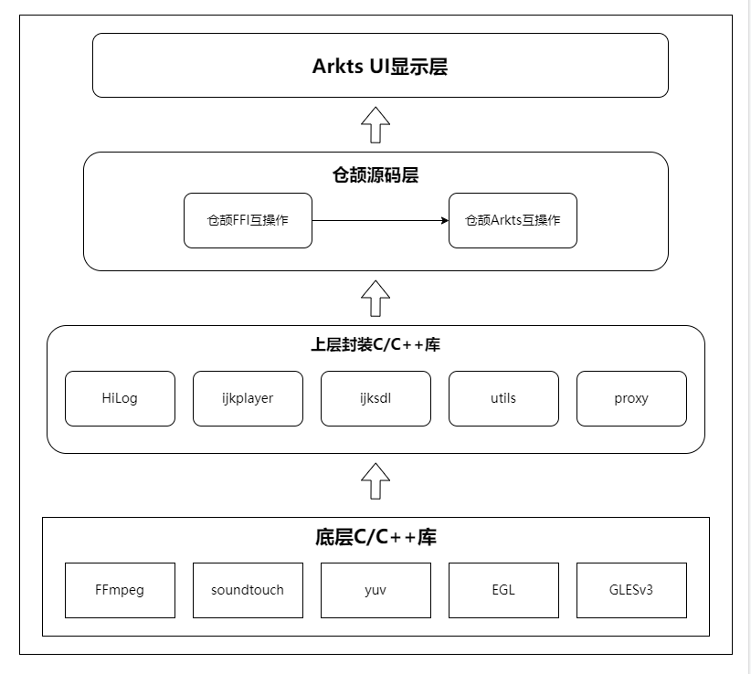

<div align="center">
<h1>ijkplayer-ffi</h1>
</div>

<p align="center">


</p>

## 介绍

ijkplayer-ffi 是仓颉环境下可用的一款基于 FFmpeg 的视频播放器。

### 特性

- 🚀 视频播放、暂停、停止、重置、释放、前进、后退、倍数播放、循环播放、设置音量、屏幕常亮

- 💪 各种事件回调监听

## 软件架构

### 架构图

<p align="center">

</p>

### 源码目录

```shell
|---- ijkplayer4cj  
|     |---- doc  # API 文档
|     |---- entry  # 示例代码文件夹
|     |---- ijkforcj  # 仓颉代码文件夹
|           |---- libs   
|           |---- src  
|                 |---- cangjie  # 仓颉模块
|     |---- ijkplayer  # ijkplayer 库文件夹
|           |---- libs  # libijkffmpeg.z.so 
|           |---- src  
|                 |---- cpp  # native模块
|                       |----- api       # ijkplayer内部业务
|                       |----- cjapi     # cangjie 内部业务
|                       |----- ijkplayer # ijkplayer内部业务
|                       |----- ijksdl    # ijkplayer内部业务
|                       |----- napi      # 封装NAPI接口
|                       |----- proxy     # 代理提供给NAPI调用处理ijkplayer内部业务
|                       |----- third_party #三方库依赖 
|                       |----- utils     #工具
|                 |---- ets  # ets接口模块
|                       |----- callback  #视频回调接口
|                       |----- common    #常量
|                       |----- utils     #工具  
|                       |----- IjkMediaPlayer.ets #ijkplayer暴露的napi调用接口
|     |---- README.MD  # 安装使用方法     
```

### 接口说明

主要类和函数接口说明详见 [API](./doc/feature_api.md)

## 使用说明

### 编译构建

依赖的三方库编译指导
1、FFmpeg:基于B站的FFmpeg版本(ff4.0--ijk0.8.8--20210426--001):FFmpeg源码链接, 由于工具链问题,请使用GN编译,编译教程参考：OpenHarmony编译构建指导. 编译脚本参考详见目录:doc/FFmpeg/

2、soudtouch:基于B站的soudtouch版本(ijk-r0.1.2-dev):soundtouch源码链接, 标准的库,可直接通过DevEco Studio cmake编译，编译脚本参考详见目录:doc/soundtouch

3、yuv:基于B站的yuv版本(ijk-r0.2.1-dev):yuv源码链接, 标准的库,可直接通过DevEco Studio cmake编译,编译脚本参考详见目录:doc/yuv

### 编译运行

1、通过IDE工具下载依赖SDK，Tools->SDK Manager->OpenHarmony SDK 把native选项勾上下载，API版本>=9

2、端测请使用镜像 OHCangjie 0.10.0 版本的mate60手机

cangjie 编译方式

    1. 请先编译 ijkforcj 文件夹生成 ijkforcj/build/default/intermediates/cj/cj_build/default/aarch64-linux-ohos/release/ijkplayer4cj/ijkplayer4cj.cjo 和 ijkforcj/build/default/intermediates/cj/cj_build/default/aarch64-linux-ohos/release/ijkplayer4cj/libijkplayer4cj_ijkplayer4cj.so
    2. 将ijkforcj文件生成的两个文件复制到 ijkplayer/libs/arm64-v8a文件夹下. 
    3. 使用 DevEco Studio NEXT Developer Beta1 构建工程项目, 生成 hap 包.

### 功能示例

在UI中配置XComponent控件

```ets
XComponent({
    id: 'xcomponentId',
    type: 'surface',
    libraryname: 'ijkplayer_napi'
})
.onLoad((context) => {
    this.initDelayPlay(context);
    })
    .onDestroy(() => {
    })
    .width('100%')
    .aspectRatio(this.aspRatio)
```
播放

```ets
let mIjkMediaPlayer = IjkMediaPlayer.getInstance();
// 设置XComponent回调的context
mIjkMediaPlayer.setContext(this.mContext);
// 设置debug模式
mIjkMediaPlayer.setDebug(true);
// 初始化配置
mIjkMediaPlayer.native_setup();
// 设置视频源
mIjkMediaPlayer.setDataSource(url); 
// 设置视频源http请求头
let headers =  new Map([
["user_agent", "Mozilla/5.0 BiliDroid/7.30.0 (xxxxxxx@xxxxx.com)"],
["referer", "https://www.xxxxxxx.com"]
]);
mIjkMediaPlayer.setDataSourceHeader(headers);
// 使用精确寻帧 例如，拖动播放后，会寻找最近的关键帧进行播放，很有可能关键帧的位置不是拖动后的位置，而是较前的位置.可以设置这个参数来解决问题
mIjkMediaPlayer.setOption(IjkMediaPlayer.OPT_CATEGORY_PLAYER, "enable-accurate-seek", "1");
// 预读数据的缓冲区大小
mIjkMediaPlayer.setOption(IjkMediaPlayer.OPT_CATEGORY_PLAYER, "max-buffer-size", "102400");
// 停止预读的最小帧数
mIjkMediaPlayer.setOption(IjkMediaPlayer.OPT_CATEGORY_PLAYER, "min-frames", "100");
// 启动预加载
mIjkMediaPlayer.setOption(IjkMediaPlayer.OPT_CATEGORY_PLAYER, "start-on-prepared", "1");
// 设置无缓冲，这是播放器的缓冲区，有数据就播放
mIjkMediaPlayer.setOption(IjkMediaPlayer.OPT_CATEGORY_PLAYER, "packet-buffering", "0");
// 跳帧处理,放CPU处理较慢时，进行跳帧处理，保证播放流程，画面和声音同步
mIjkMediaPlayer.setOption(IjkMediaPlayer.OPT_CATEGORY_PLAYER, "framedrop", "5");
// 最大缓冲cache是3s， 有时候网络波动，会突然在短时间内收到好几秒的数据
// 因此需要播放器丢包，才不会累积延时
// 这个和第三个参数packet-buffering无关。
mIjkMediaPlayer.setOption(IjkMediaPlayer.OPT_CATEGORY_PLAYER, "max_cached_duration", "3000");
// 无限制收流
mIjkMediaPlayer.setOption(IjkMediaPlayer.OPT_CATEGORY_PLAYER, "infbuf", "1");
// 屏幕常亮
mIjkMediaPlayer.setScreenOnWhilePlaying(true);
// 设置超时
mIjkMediaPlayer.setOption(IjkMediaPlayer.OPT_CATEGORY_FORMAT, "timeout", "10000000");
mIjkMediaPlayer.setOption(IjkMediaPlayer.OPT_CATEGORY_FORMAT, "connect_timeout", "10000000");
mIjkMediaPlayer.setOption(IjkMediaPlayer.OPT_CATEGORY_FORMAT, "listen_timeout", "10000000");
mIjkMediaPlayer.setOption(IjkMediaPlayer.OPT_CATEGORY_FORMAT, "addrinfo_timeout", "10000000");
mIjkMediaPlayer.setOption(IjkMediaPlayer.OPT_CATEGORY_FORMAT, "dns_cache_timeout", "10000000");

let mOnVideoSizeChangedListener: OnVideoSizeChangedListener = {
onVideoSizeChanged(width: number, height: number, sar_num: number, sar_den: number) {
    that.aspRatio = width / height;
    LogUtils.getInstance()
    .LOGI("setOnVideoSizeChangedListener-->go:" + width + "," + height + "," + sar_num + "," + sar_den)
    that.hideLoadIng();
}
}
mIjkMediaPlayer.setOnVideoSizeChangedListener(mOnVideoSizeChangedListener);
let mOnPreparedListener: OnPreparedListener = {
onPrepared() {
    LogUtils.getInstance().LOGI("setOnPreparedListener-->go");
}
}
mIjkMediaPlayer.setOnPreparedListener(mOnPreparedListener);

let mOnCompletionListener: OnCompletionListener = {
onCompletion() {
    LogUtils.getInstance().LOGI("OnCompletionListener-->go")
    that.currentTime = that.stringForTime(mIjkMediaPlayer.getDuration());
    that.progressValue = PROGRESS_MAX_VALUE;
    that.stop();
}
}
mIjkMediaPlayer.setOnCompletionListener(mOnCompletionListener);

let mOnBufferingUpdateListener: OnBufferingUpdateListener = {
onBufferingUpdate(percent: number) {
    LogUtils.getInstance().LOGI("OnBufferingUpdateListener-->go:" + percent)
}
}
mIjkMediaPlayer.setOnBufferingUpdateListener(mOnBufferingUpdateListener);

let mOnSeekCompleteListener: OnSeekCompleteListener = {
onSeekComplete() {
    LogUtils.getInstance().LOGI("OnSeekCompleteListener-->go")
    that.startPlayOrResumePlay();
}
}
mIjkMediaPlayer.setOnSeekCompleteListener(mOnSeekCompleteListener);

let mOnInfoListener: OnInfoListener = {
onInfo(what: number, extra: number) {
    LogUtils.getInstance().LOGI("OnInfoListener-->go:" + what + "===" + extra)
}
}
mIjkMediaPlayer.setOnInfoListener(mOnInfoListener);

let mOnErrorListener: OnErrorListener = {
onError(what: number, extra: number) {
    LogUtils.getInstance().LOGI("OnErrorListener-->go:" + what + "===" + extra)
    that.hideLoadIng();
    prompt.showToast({
    message:"亲，视频播放异常，系统开小差咯"
    });
}
}
mIjkMediaPlayer.setOnErrorListener(mOnErrorListener);

mIjkMediaPlayer.setMessageListener();

mIjkMediaPlayer.prepareAsync();

mIjkMediaPlayer.start();

```
暂停

```ets
mIjkMediaPlayer.pause();
```

停止
```ets
mIjkMediaPlayer.stop();
```

重置

```ets
mIjkMediaPlayer.reset();
```

释放

```ets
mIjkMediaPlayer.release();
```
跳到指定时间节点的视频处

```ets
mIjkMediaPlayer.seekTo(10);
```
倍数播放

```ets
mIjkMediaPlayer.setOption(IjkMediaPlayer.OPT_CATEGORY_PLAYER, "soundtouch", "1");
mIjkMediaPlayer.setSpeed("2");
```

屏幕常亮

```ets
mIjkMediaPlayer.setScreenOnWhilePlaying(true);
```

循环播放

```ets
mIjkMediaPlayer.setLoopCount(true);
```

设置音量

```ets
mIjkMediaPlayer.setVolume(0, 1);
```


## 约束与限制

支持视频格式:
- .mp4

在下述版本验证通过：

- DevEco Studio: 5.0.3.500
- cangjie SDK:  OHCangjie 0.10.0
- Cangjie support Plugin: 5.0.3.500


## 开源协议 License

本项目基于 [LGPLv2.1 or later](LICENSE)，请自由地享受和参与开源。

## 参与贡献

欢迎给我们提交PR，欢迎给我们提交Issue，欢迎参与任何形式的贡献。